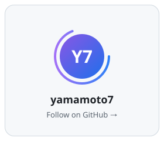
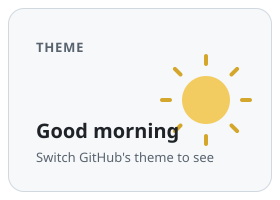

<a href="https://github.com/yamamoto7"><picture><source media="(prefers-color-scheme: dark)" srcset="works/hero-dark.svg"></picture></a>

# README lab

**Everything on this page is a plain image in a README.** No JavaScript, no CSS, no external server.
GitHub strips `<style>` and `<script>`, so each piece is an SVG that animates, follows your theme, adapts to your screen and links where you click.

Switch GitHub's theme, resize the window or open this page on your phone. The pieces react.

## Aurora

The banner at the top. Blurred light drifts behind the name, stars twinkle and a shooting star crosses now and then.

- Dark and light are two SVGs picked by `<picture>`, so they follow the theme set on GitHub.
- On a phone, the SVG notices it is rendered narrow and swaps to a large-type layout. One file, no extra markup.
- Motion stops for people who ask their OS to reduce it.

Source: [`hero-dark.svg`](works/hero-dark.svg) · [`hero-light.svg`](works/hero-light.svg)

## Terminal

<a href="https://github.com/yamamoto7/oss-activity-card"><picture></picture></a>

Commands type themselves out, character by character, and the results scroll in. Reload the page to replay it.

- Typing is a cover that shrinks in steps, one step per character, with a caret riding along.
- Each line appears on its own delay. All CSS, inside the SVG.

Source: [`terminal.svg`](works/terminal.svg)

## Bento

<a href="https://github.com/yamamoto7/oss-activity-card"><picture><source media="(prefers-color-scheme: dark)" srcset="works/bento-oss-dark.svg"></picture></a><a href="https://github.com/yamamoto7"><picture><source media="(prefers-color-scheme: dark)" srcset="works/bento-me-dark.svg"></picture></a><a href="https://github.com/yamamoto7/readme-lab"><picture><source media="(prefers-color-scheme: dark)" srcset="works/bento-now-dark.svg"></picture></a><a href="https://github.com/yamamoto7/oss-activity-card"><picture><source media="(prefers-color-scheme: dark)" srcset="works/bento-stack-dark.svg"></picture></a><a href="https://github.com/yamamoto7/readme-lab/tree/main/experiments"><picture><source media="(prefers-color-scheme: dark)" srcset="works/bento-theme-dark.svg"></picture></a>

Every tile is its own image inside its own link, so **each tile is clickable**. Try it.

- Widths are percentages, so the grid keeps its shape from a wide monitor down to a phone.
- The bars rise, the ring spins and the dot pings. The theme tile shows a moon or a sun to match your GitHub theme.

## Linked card

A real-world piece: [oss-activity-card](https://github.com/yamamoto7/oss-activity-card) cuts a card into one image per row, wraps each row in a link and stacks them so they read as one card. See it on [my profile](https://github.com/yamamoto7).

## How far can it go?

The [experiments](experiments) folder tests each building block on github.com: what the sanitizer keeps, which media queries work, animation, `foreignObject`, web fonts and expandable rows.
