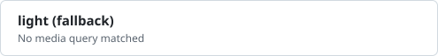
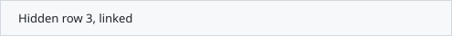

# README lab

Experiments for the article "GitHub READMEで、どこまでリッチなカードを作れるか": what a GitHub README can render, tested on github.com.
Each section shows one technique. Switch GitHub's theme, resize the window or open this page on a phone to see them react.

## 1. Theme switching

<picture><source media="(prefers-color-scheme: dark)" srcset="../img/theme-picture-dark.svg"></picture>

## 2. Responsive

<picture><source media="(max-width: 600px)" srcset="../img/responsive-narrow.svg"></picture>

<picture><source media="(prefers-color-scheme: dark) and (max-width: 600px)" srcset="../img/compound-dark-narrow.svg"><source media="(prefers-color-scheme: dark)" srcset="../img/compound-dark.svg"></picture>

## 3. Touch or mouse

<picture><source media="(hover: none)" srcset="../img/pointer-touch.svg"></picture>

## 4. Animation

<picture><source media="(prefers-reduced-motion: reduce)" srcset="../img/anim-static.svg"></picture>

## 5. foreignObject and web fonts

## 6. Expandable rows

<picture></picture>

<a href="https://github.com/yamamoto7/readme-lab/tree/main/experiments#1-theme-switching" title="Hidden row 1"><picture></picture></a>
<a href="https://github.com/yamamoto7/readme-lab/tree/main/experiments#2-responsive" title="Hidden row 2"><picture></picture></a>
<a href="https://github.com/yamamoto7/readme-lab/tree/main/experiments#3-touch-or-mouse" title="Hidden row 3"><picture></picture></a>
 

## 7. Tooltips

<a href="https://github.com/yamamoto7/oss-activity-card" title="title on the link: shown on hover"><picture></picture></a>
